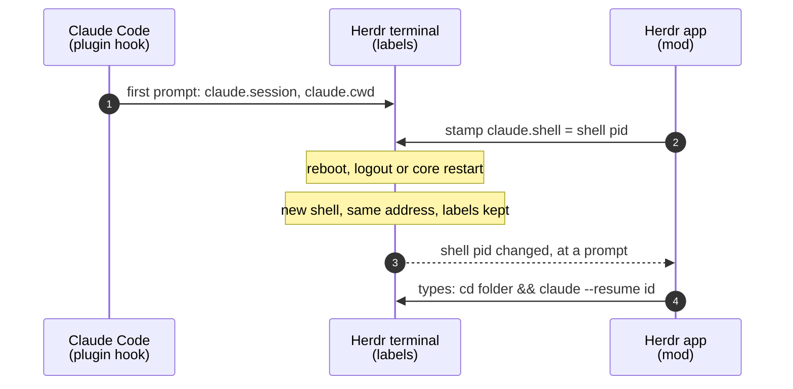

<p align="center">
  <picture>
    <source media="(prefers-color-scheme: dark)" srcset=".github/assets/wordmark-on-dark.svg">
    
  </picture>
</p>

<h3 align="center">Your Claude Code conversations survive a reboot.</h3>

<p align="center">
  When <a href="https://herdr.dev">Herdr</a> brings a terminal back after a restart,<br>
  the Claude session that was running in it reopens where you left it.
</p>

<p align="center">
  <a href="#install">install</a> ·
  <a href="#how-it-works">how it works</a> ·
  <a href="#behaviour">behaviour</a> ·
  <a href="#repository-map">code</a>
</p>

<p align="center">
  <a href="https://github.com/matthewjfberry/herdr-claude-resume/actions/workflows/ci.yml"></a>
  
  
  
  <a href="LICENSE"></a>
</p>

---

Herdr keeps terminals alive while its window is closed, but a reboot, logout or core restart still ends them. Each comes back as a fresh shell in its last folder, and whatever was running there is gone. For a Claude Code session that means hunting for the right `claude --resume <id>` in every pane. This does it for you.

## How it works

Two small parts talk through labels on the Herdr terminal itself, so nothing is stored anywhere else.



- **The plugin** labels the terminal on the first prompt, and removes the labels when you `/exit`, `/clear` or log out. When Claude is killed instead (a reboot, a hangup), it reports `reason: "other"` and the labels stay.
- **The mod** stamps the shell each session runs under. A labelled terminal with a different shell lost its program, so the mod types the resume into the new shell.

A resume needs a new shell. Quitting Claude, or Claude crashing in a shell that is still alive, never triggers one.

## Install

You need [Claude Code](https://claude.com/claude-code) and the [Herdr](https://herdr.dev) desktop app.

**1. The Claude Code plugin**

```sh
claude plugin marketplace add matthewjfberry/herdr-claude-resume
claude plugin install herdr-claude-resume@herdr-claude-resume
```

**2. The Herdr mod**

A mod runs only while a layout hosts it, and Herdr's shipped layouts are read-only, so it needs a personal copy of your layout. Skip the clone if you already have one.

```sh
git clone https://github.com/matthewjfberry/herdr-claude-resume
cp -R herdr-claude-resume/mods/claude-resume ~/.config/herdr-app/mods/
herdr-app do layout.clone '{"name":"main","as":"my-layout"}'
```

Add the mod to the root node of `~/.config/herdr-app/layouts/my-layout.json`, or to its existing `floating` list. It renders nothing, so you won't see it.

```json
"floating": [
  { "id": "claude-resume", "content": { "mod": "claude-resume" }, "edge": "bottom", "align": "end" }
]
```

**3. Check it**

```sh
herdr-app check ~/.config/herdr-app/mods/claude-resume   # Check passed
herdr-app status                                         # claude-resume under "floats", no errors
```

Start Claude in a Herdr terminal and send a prompt. Within two seconds, `hc get <terminal>` shows `claude.session`, `claude.cwd` and `claude.shell`.

**4. Adopt sessions already open (optional)**

Claude Code loads hooks when a session starts, so sessions running before the install never call the plugin. Adopt them once:

```sh
./herdr-claude-resume/adopt.sh
```

```
t5  adopted web (265b74fd-df44-42dd-b0fb-206973e4e913)
t6  already covered
t7  skipped: no conversation saved yet
```

It reads each session's id from Claude Code's own `~/.claude/sessions/<pid>.json`. That file is internal to Claude Code, which is why only this one-off script relies on it, never the mod. Needs `jq`.

## Behaviour

| When | What happens |
|---|---|
| Reboot, logout or core restart | The session reopens in its own terminal and folder |
| `/exit` or Ctrl-D | Labels removed, nothing reopens |
| `/clear` or `/resume` | The new session is labelled at its next prompt |
| Claude crashes, shell still alive | Nothing. `claude --continue` is one command away |
| A session with no prompt yet | Nothing. Claude saved no conversation to resume |
| Herdr app restart or update | Nothing needed. Terminals keep running |

## Repository map

| Path | Lines | Role |
|---|---:|---|
| [`hooks/label.sh`](hooks/label.sh) | 30 | Labels the terminal on `UserPromptSubmit`, clears it on `SessionEnd` |
| [`hooks/hooks.json`](hooks/hooks.json) | 10 | Registers the two hooks with Claude Code |
| [`mods/claude-resume/plan.js`](mods/claude-resume/plan.js) | 33 | Every decision, as one pure function: stamp, resume or nothing |
| [`mods/claude-resume/main.js`](mods/claude-resume/main.js) | 42 | Reads Herdr's terminals every 2 s and runs `hc` for each step |
| [`mods/claude-resume/plan.test.mjs`](mods/claude-resume/plan.test.mjs) | 57 | `node:test` suite for `plan.js` |
| [`adopt.sh`](adopt.sh) | 46 | One-off: labels sessions that were open before the install |
| [`.claude-plugin/`](.claude-plugin) | | Plugin manifest and its one-plugin marketplace |

POSIX `sh` and plain JavaScript, with no packages, no build step and no network access. Folder names are single-quoted and session ids must be UUIDs before anything reaches a shell.

## Limits

- A resume starts up to 2 seconds after the new shell, the mod's check interval.
- The mod must run before the loss to stamp the shell. A session started while the app was closed, then lost before it opened, is not resumed.
- Sessions already running at install time are covered only after [`adopt.sh`](#install) or a restart.
- The resume is typed into the shell, so it lands in your shell history.
- Tested on local terminals. A remote machine needs the plugin installed there too.

## Uninstall

```sh
claude plugin uninstall herdr-claude-resume@herdr-claude-resume
rm -r ~/.config/herdr-app/mods/claude-resume
```

Then remove the `claude-resume` entry from your layout.

## Development

```sh
node --test mods/claude-resume/plan.test.mjs
shellcheck hooks/label.sh adopt.sh
herdr-app check mods/claude-resume
```

CI runs the first two and validates every JSON manifest.

## Credit

The mod structure and install steps follow [herdr-tab-autoname](https://github.com/OliverRC/herdr-tab-autoname) by Oliver Rivett-Carnac.

## Licence

[MIT](LICENSE)
